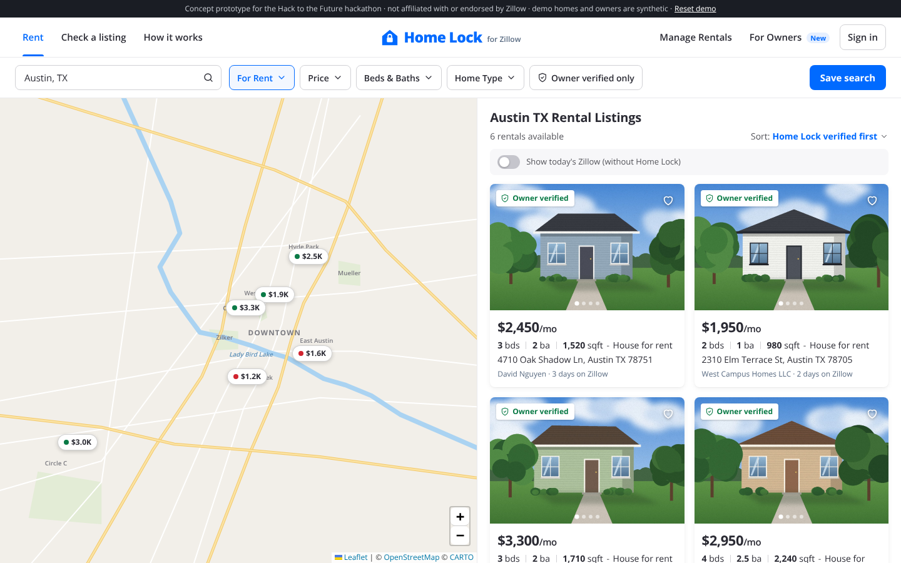
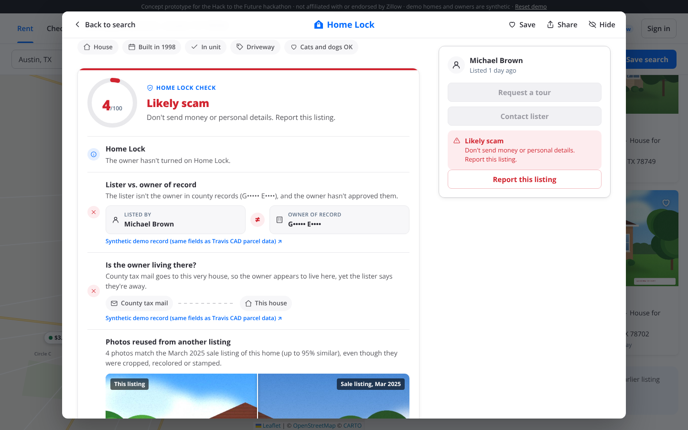
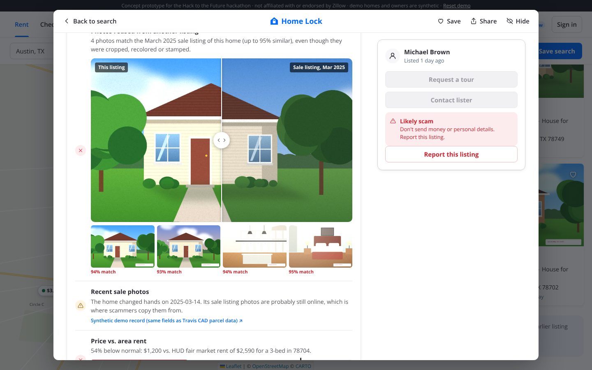
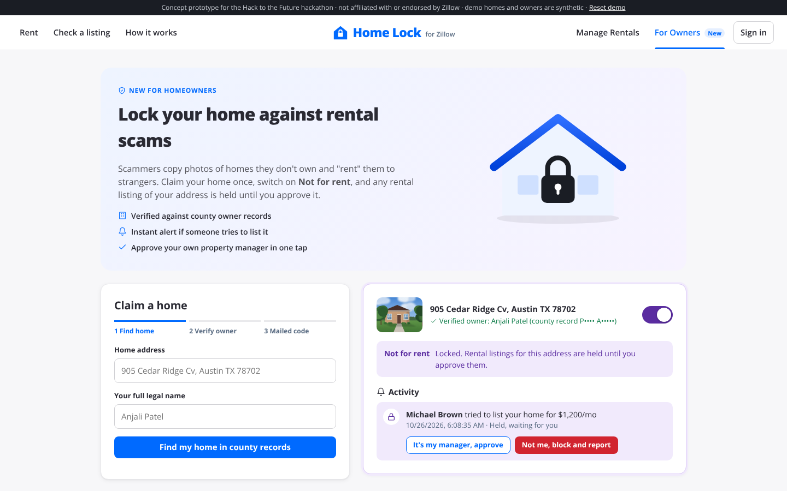
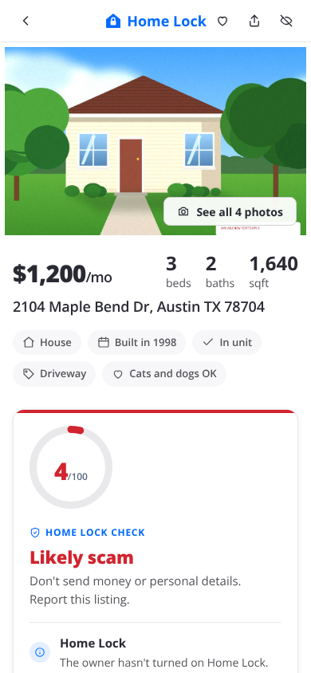

# Home Lock for Zillow Rentals

**The feature Zillow is missing: a way for homeowners to stop scammers from renting out their house, and a way for renters to see evidence that a listing is real.**

> Concept prototype built for the [Hack to the Future](https://hack-to-the-missing-future-ai.devpost.com/) hackathon. Not affiliated with or endorsed by Zillow.

## The problem

Scammers copy a real home's photos from an old sale listing, post it "for rent" far below market, say they're out of the country, and collect a deposit by Zelle or wire. Renters show up to an empty lockbox. Owners find out from a neighbor.

- A Highlands Ranch, Colorado family found their house listed for rent on Zillow with photos from when they bought it. After they reported it, the listing came back with only the first photo changed. Dozens of neighbors said they'd been targeted too. ([Denver7](https://www.denver7.com/news/local-news/highland-ranch-familys-home-put-up-for-rent-without-their-permission-on-zillow))
- A Durham mom lost hundreds on a fake Zillow rental. ([ABC11](https://abc11.com/finance/zillow-dream-home-turns-out-to-be-durham-scam/5609294/))
- Zillow's current defense is a generic "Beware of rental scams" warning on every listing, a report button, and removing fakes after the fact. Nothing stops someone from listing a home they don't own, and renters are told to check the county assessor's site themselves.

## Before and after

| Today | With Home Lock |
|---|---|
| Every listing shows the same generic scam warning. | Each listing shows a verdict (*Owner verified*, *Caution*, *Likely scam*, *Held by owner's Home Lock*) with the evidence behind it. |
| Anyone can list any address for rent. | Owners claim their home and switch on **Not for rent**. Rental listings of a locked home are held until the owner approves them, and the owner gets an alert. |
| Renters must research ownership themselves. | The lister is checked against the county's owner of record automatically, and renters see only a masked name. |











## What it checks

| Check | Data | Why it matters |
|---|---|---|
| Lister vs. owner of record | [Travis Central Appraisal District parcel layer](https://taxmaps.traviscountytx.gov/arcgis/rest/services/Parcels/FeatureServer/0), queried live | Scammers aren't the owner. Name matching handles "LAST FIRST & SPOUSE", initials and trusts. |
| Is the owner living there? | Owner's tax mailing address vs. the property address | If tax mail goes to the house itself, it's probably the owner's home, not a vacant rental. If the lister also claims to be "out of the country", that's a contradiction. |
| Photos reused from another listing | The home's earlier listing photos (Zillow already has this archive) | Copied photos still match after cropping, recoloring, recompression or a stamped caption. |
| Recent sale | County deed date | Recently sold homes have fresh listing photos online, which is where scammers copy them from. |
| Price vs. area rent | [HUD FY2027 Small Area Fair Market Rents](https://www.huduser.gov/portal/datasets/fmr/smallarea/index.html) by ZIP and bedroom count | "Too good to be true" pricing is the bait. Zillow would use its Rent Zestimate. |
| Scam language | Listing text and messages | Wire, Zelle or gift cards; "out of the country"; "keys will be mailed"; moving to WhatsApp; deposit before a showing. |
| Home Lock | Owner's lock and approvals | Locked homes can't be listed without the owner. |

## Try it

```bash
git clone https://github.com/debi910/zillow-home-lock.git
cd zillow-home-lock
npm start          # node server.mjs, no dependencies to install
# open http://localhost:8080
```

Node 18 or newer. `npm test` runs the unit tests.

**Demo walkthrough**

1. **Rent** (`#/rent`): a Zillow-style map and list of six Austin rentals. Each card and map pin carries a Home Lock label, and verified homes sort first. Open *2104 Maple Bend Dr* to see a likely scam. The lister isn't the owner, the owner lives there, the photos match the home's 2025 sale listing (drag the slider to compare), the rent is 54% below HUD's rate, and the scam phrases are highlighted. Switch on *Show today's Zillow* to see what renters get now.
2. **For Owners** (`#/home-lock`): claim *905 Cedar Ridge Cv* as **Anjali Patel**. Try another name first; it's rejected because it doesn't match county records. Enter the mailed code, then switch on **Not for rent**.
3. **Manage Rentals** (`#/rental-manager`): list *905 Cedar Ridge Cv* as anyone else. The listing is held, and the owner sees an alert with *approve* or *block and report*.
4. **Check a listing** (`#/check`): type a real Austin address (for example, one from a Craigslist ad). Owner, occupancy and sale data come live from Travis County.

*Reset demo* in the top bar clears the saved claims, locks and alerts.

The demo homes, owners and photos are synthetic (`src/fixtures.js`, `tools/make_demo_photos.py`), so the demo never accuses a real person. Real addresses on the *Check any listing* page use live public county records, and the owner's name is shown masked.

## How it works

```
index.html, styles.css    Page shell, Zillow-style layout, motion and responsive rules
src/app.js                Routes and views: rentals, listing detail, rental manager, owner dashboard, live check
src/ui.js                 Icons, toasts, animated score ring and numbers, photo comparison slider
src/map.js                Results map: Leaflet with price pins, plus a drawn Austin map used offline
src/checks.js             All checks and the verdict (pure functions, unit tested)
src/county.js             Travis County parcel lookup: direct, then via server.mjs proxy
src/phash.js              Photo matching: normalized thumbnails + cross-correlation over crop windows
src/fmr.js                HUD FY2027 Small Area Fair Market Rents for Austin ZIPs
src/store.js              Demo persistence (localStorage) for claims, locks, alerts, listings
server.mjs                Zero-dependency static server and county API proxy
tools/make_demo_photos.py Generates the synthetic photos and their disguised copies
tests/                    node:test unit tests
vendor/leaflet/           Leaflet 1.9.4 (BSD-2-Clause), vendored so the app needs no CDN
```

The app runs entirely in the browser. It works as a static site too (for example on GitHub Pages). There, the live county lookup works only if the county server allows cross-origin requests, and `npm start` always works.

## How Zillow could roll it out

Start with owner-occupied homes in the metros with the most rental-scam reports. Home Lock reuses Zillow's existing home claiming, photo archive and Rent Zestimate. County owner-of-record data is public in every U.S. county.

## Design

The UI recreates the layout of Zillow's rental search (map on the left, cards on the right, listing details in a modal) so judges can picture Home Lock inside the real product. It doesn't use Zillow's logo or assets.

Motion follows [Emil Kowalski's design-engineering principles](https://emilkowal.ski/): custom ease-out curves, UI animations under 300ms, only `transform` and `opacity` animated, buttons that scale down slightly when pressed, popovers that grow from their trigger, Sonner-style toasts, staggered check results, and hover effects only on devices with a mouse. Everything respects `prefers-reduced-motion`.

## Built with

HTML, CSS and JavaScript (ES modules, no framework or build step), Node.js (built-ins only), Leaflet with OpenStreetMap and CARTO map tiles, Open Sans (Google Fonts), Python with Pillow (to generate demo photos), Travis Central Appraisal District public ArcGIS REST API, HUD Small Area Fair Market Rents. Built with help from Claude (Anthropic) as an AI coding assistant.

## Limits

- Name matching can't tell when an owner uses a property manager. That's why the owner can approve a manager.
- Owners who mail tax bills elsewhere still pass the occupancy check.
- Photo matching was tuned on the synthetic demo photos. Disguised copies score 93 to 96%. Different homes mostly score lower, but two similar synthetic rooms can reach about 94%, so the app only compares a listing with past photos of the same address.
- The code-by-mail step is simulated in the demo.

## License

MIT
